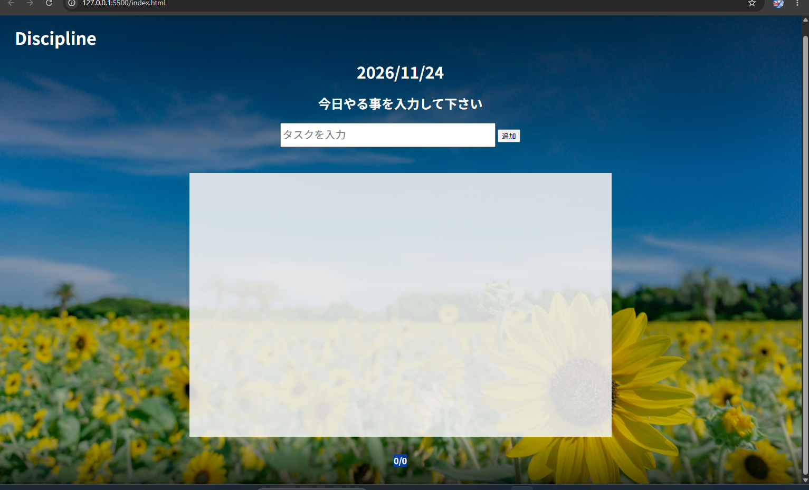

# Discipline
やる事をまとめて、毎日をより生産的にするためのToDoアプリです。

## 機能
- 追加
- チェックで横線
- 削除
- 完了数の表示
- 日付が変わるとリセット
- リロードしても消えない

## 使った技術
HTML / CSS / JavaScript / localStorage

## 工夫した点
日付が一目でわかるように、JavaScriptで今日の日付を取得して、HTMLに表示しました。

また、日付が変わったタイミングでタスクをリセットできるようにしました。前回開いたときの日付を保存しておき、次にサイトを開いたときの日付と比べて、異なる場合はタスクがすべて消えるようにしました。

他には、背景の写真の上に半透明の黒を重ねて、少し暗くしました。

## 苦労した点・学んだこと
学習教材ではなく、AIに質問しながら1から自分でコードを書いて作りました。アイデアを教材で学んだことになかなか落とし込めず、大変でした。知らない知識や足りない点は、出会うたびに調べることで経験不足を補いながら制作しました。また、わからないことはわからないままにせず、時間をかけてでも自分のコードを自分の言葉で説明できるようにすることを意識して取り組みました。

初めて自分でコードを書いてみて、思った通りに動いたときの感動や喜びを知りました。特にaddEventListenerでEnterキーでもタスクを追加できるようにした時、普段何気なく使っている技術の裏にこういった努力があるんだと知りました。

技術的な面では、今までは教材の指示に従って決められた枠組みの中でコードを考えていましたが、今回はどこにコードの発火点を置くかなどを自分で考える必要があり、苦労しました。

localStorage.setItem/getItemの理解にも苦戦しました。特に削除ボタンを作った時、画面とデータの両方を修正して保存し直さないといけないという点で迷い、リロードすると消したはずのタスクが再表示されてしまうことに苦戦しました。

